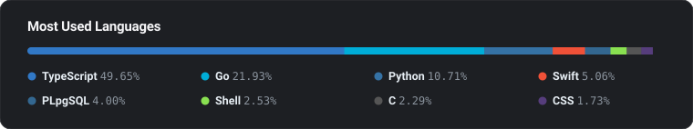

Building high-throughput data systems, embedded firmware research, local ML runtimes, and native platform tools. Minimal dependencies, on-device execution, and reliable production architectures.

### Focus Areas

#### 📈 Market Microstructure & Streaming
- Low-latency multi-exchange order-flow ingestion pipelines (Go)
- High-volume time-series storage & analytical queries (ClickHouse)
- Real-time metrics: Level 2 order book heatmaps, CVD, Open Interest, and anomaly detection
- Custom high-framerate canvas charting engine with scriptable indicators (TypeScript)

#### 🌐 Infrastructure & Production DevOps
- Linux VPS administration, server hardening, firewall setup, and reverse proxying
- Automated build pipelines, versioned deployments, and zero-downtime release rollouts
- 24/7 service supervision, automated crash recovery, and health checks (systemd, Docker)
- ClickHouse partition management and retention policies under heavy disk I/O

#### 🔬 Embedded Research & Reverse Engineering
- Proprietary ARM firmware decomposition, static analysis, and hardware emulation
- Extending closed-source firmwares: algorithmic hardware control and custom UI overlays (C, Rust, Python)
- Low-level network research via Berkeley Packet Filters (BPF) and raw sockets
- Bare-metal and RTOS firmware development for microcontrollers (ESP32 / ESP-IDF)

#### 🧠 On-Device Machine Learning
- Fast local LLM inference on Apple Silicon unified memory (Apple MLX, Python)
- Fully offline agent runtimes, tool-calling pipelines, and autonomous workflows
- Memory-efficient tensor execution and quantization under constrained environments

#### 💻 Systems & Native Interfaces
- Zero-dependency macOS desktop tools interfacing directly with kernel APIs (Swift, SwiftUI)
- Custom Android launcher tailored for remote/D-pad navigation without root access (Kotlin)
- Defensive software design: minimal third-party dependencies and deterministic codebases

### Stack & Codebase

  
  
  
  
  
  
  
  
  
  
  
  

