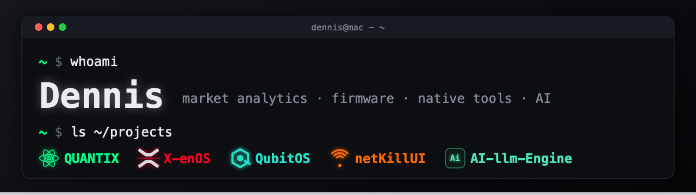

I build systems for market analysis and tools that run on the device in front
of you: a real-time crypto order-flow platform, firmware research for cameras
and microcontrollers, native macOS apps in Swift, an Android home screen for a
projector, and local LLM inference on Apple Silicon. Documented decisions, small
dependency trees, and nothing sent to a cloud that doesn't need to be.

### QUANTIX · *private*

My largest project: a professional order-flow analytics platform for crypto
markets.

- **Multi-exchange ingestion** — Binance Futures, Bybit, OKX, Hyperliquid,
  Kraken, Coinbase and BingX streamed into one pipeline.
- **Go microservices** — ingestor, processor, API, historian and admin worker
  over NATS JetStream, ClickHouse and Redis.
- **Order flow** — L2 depth heatmap, CVD, open interest, funding, liquidation
  bubbles, footprint data and multi-chart sync.
- **Anomaly engine** — five statistically gated detectors: volume spikes, limit
  walls, trade climaxes, liquidation spikes and spoofing.
- **Workspace** — eleven live widgets, a multi-monitor layout and Telegram /
  email alerts set directly on the chart.
- **Charting** — built on [**KLineChart-Pro**](https://github.com/dsavenk0/KLineChart-Pro),
  my extended edition of [KLineChart](https://github.com/klinecharts/KLineChart):
  undo/redo for drawings and indicators, collapsible and reorderable indicator
  panes, a JavaScript indicator script editor, a brush tool with RDP path
  simplification, HMA / Pivot Points / VWAP indicators, indicator search and
  i18n.

Next.js · TypeScript · Go · ClickHouse · NATS · Redis · Docker

### Other projects

| | Project | What it is | Stack |
|---|---|---|---|
| 🧠 | [**AI-llm-Engine**](https://github.com/dsavenk0/AI-llm-Engine) | Local-first AI workspace for macOS: fast Qwen / JANG inference, agents and workflows on Apple Silicon (MLX) | Python · MLX |
| 📷 | **X-enOS** · *private* | Firmware extensions for Fujifilm X cameras, starting with the X-T10: software AF-S/AF-C/MF, a stock-style menu and film presets, built through firmware decomposition and emulation | Python · Rust · C |
| 📺 | **QubitOS** · *private* | A home screen for an Android projector, designed for a physical remote: predictive D-pad keyboard, browser, app library; no root, stock firmware untouched | Kotlin · Android |
| 📡 | **netKillUI** · *private* | Native macOS ARP toolkit in SwiftUI with zero dependencies: device discovery, cut and intercept modes, stealth mode, spoof detection | Swift · BPF |
| 🛰️ | **netKill-esp32** · *private* | Standalone ESP32 Wi-Fi multitool with a Flipper-style web launcher | C · ESP-IDF |

### Stack

  
  
  
  
  
  
  
  
  
  

### How I work

- **On-device first.** Models, tools and data stay where the user is.
- **Evidence over assumption.** Reverse-engineering results are hash-bound,
  emulated before they touch hardware, and recorded with their limits.
- **Small and native.** Few dependencies, platform APIs, readable code.

Private projects are listed for context; their repositories are not public yet.
